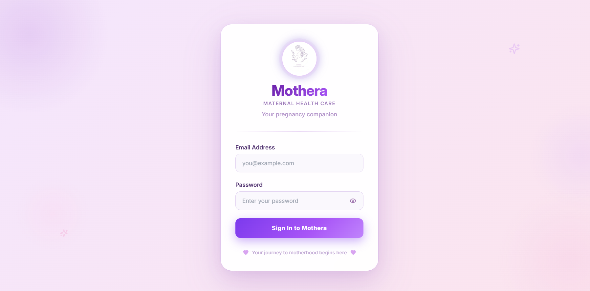
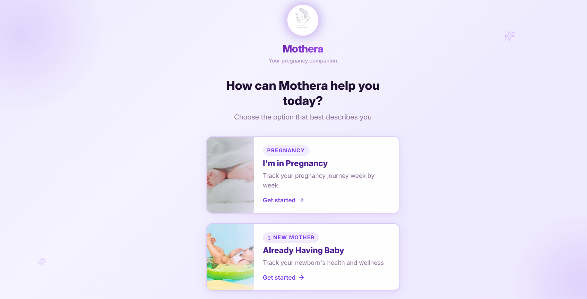
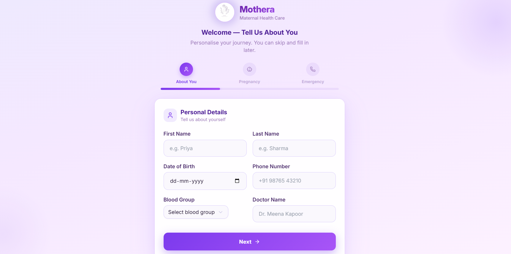
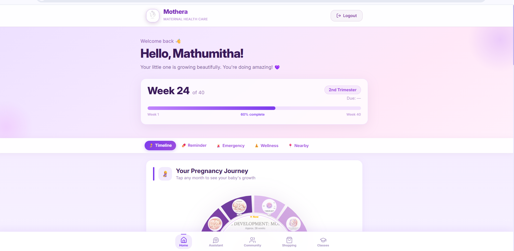
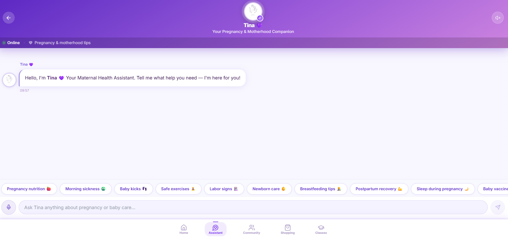
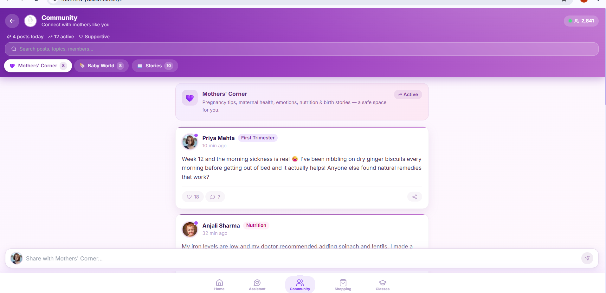
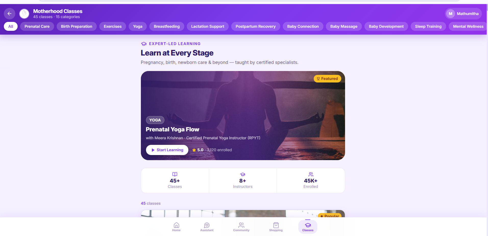

# Mothera — Maternal Health Care 🌸

**Mothera** is a maternal health and motherhood companion web application designed to bring pregnancy tracking, maternal wellness, an AI-style assistant, community support, and educational classes into one user-friendly platform.

> **Live Demo:** https://mothera-yuk.caffeine.xyz/

## ✨ Key Features

- 🔐 User sign-in interface
- 🤰 Pregnancy and motherhood onboarding
- 👤 Personal profile setup
- 📅 Pregnancy timeline and week-by-week progress
- 🤖 Tina — maternal health assistant interface
- 💬 Community space for mothers
- 🎓 Motherhood learning classes
- 🧘 Wellness and pregnancy education sections
- 📱 Responsive, modern UI with a soft purple/pink visual theme

## 🖥️ Application Screens

### Login


### User Selection


### Personal Details


### Pregnancy Dashboard


### Maternal Health Assistant


### Community


### Motherhood Classes


## 🛠️ Technologies

The original live prototype was created using a visual/AI-assisted web development workflow. This repository contains a **portfolio-ready static recreation/documentation version** based on the project's UI screens.

- HTML5
- CSS3
- JavaScript
- Responsive Web Design
- Modern UI/UX principles

## 📁 Repository Structure

```text
Mothera-GitHub/
├── index.html
├── styles.css
├── script.js
├── README.md
├── .gitignore
└── screenshots/
    ├── 01-login.png
    ├── 02-user-type.png
    ├── 03-profile.png
    ├── 04-dashboard.png
    ├── 05-assistant.png
    ├── 06-community.png
    └── 07-classes.png
```

## 🚀 Run Locally

1. Download or clone this repository.
2. Open the project folder.
3. Open `index.html` in a browser.

For a better development experience, use the **Live Server** extension in Visual Studio Code.

## 🎯 Project Objective

Mothera aims to provide a single digital space where mothers can:

- understand their pregnancy journey,
- track important milestones,
- access educational resources,
- interact with a supportive community,
- and access a conversational maternal-health assistant interface.

## 🔮 Future Enhancements

- Secure authentication and user accounts
- Real database integration
- Personalized pregnancy calculations
- Appointment and medication reminders
- Verified healthcare professional content
- Location-based healthcare resources
- AI assistant connected to a medically reviewed knowledge base
- Mobile application
- Accessibility improvements

## ⚠️ Disclaimer

Mothera is a student/portfolio project and should not be used as a substitute for professional medical advice, diagnosis, or treatment.

## 👩‍💻 Author

**Mathumitha Mohan**

Computer Science Undergraduate

---

### Live Project

https://mothera-yuk.caffeine.xyz/
